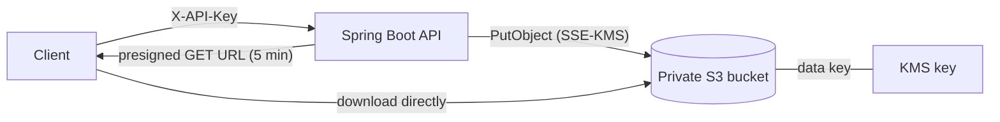

# Secure File Locker

A Spring Boot REST service for storing files securely in Amazon S3.
Files are encrypted at rest with AWS KMS, the bucket is private, and downloads go through
short-lived presigned URLs, so the service never streams file contents back itself.

**Stack:** Java 21, Spring Boot 3, AWS SDK for Java v2 (S3, KMS), JUnit 5, Mockito, MockMvc,
Docker, Docker Compose, LocalStack, Terraform, GitHub Actions



## Security design
| Concern | How it's handled |
|---|---|
| Data at rest | Every object is written with SSE-KMS using a dedicated, auto-rotated KMS key |
| Public exposure | Block Public Access on, ACLs disabled, TLS-only bucket policy |
| Downloads | Presigned GET URLs that expire after 5 minutes (configurable) |
| Authentication | `X-API-Key` header, compared in constant time; the app refuses all requests if no key is configured |
| Key/path injection | Files are addressed only by a server-generated UUID; filenames are sanitized (path segments stripped, unsafe characters replaced, length capped) |
| Least privilege | The app's IAM role can only list/read/write/delete in its bucket and use its own KMS key |
| Integrity | SHA-256 of each upload is returned to the client and stored as object metadata |
| Error leakage | AWS errors are logged server-side; clients get a generic `502` |
| Runtime | Docker image runs as a non-root user on a JRE-only base |
| Upload limits | 10 MB by default (`MAX_FILE_SIZE`); oversized uploads get `413` |

## API
All endpoints except `/actuator/health` require `X-API-Key`.

| Method | Path | Result |
|---|---|---|
| POST | `/files` (multipart, field `file`) | `201` `{id, name, size, uploadedAt, sha256}` |
| GET | `/files` | list of files |
| GET | `/files/{id}/download-url` | `{url, expiresAt}` |
| DELETE | `/files/{id}` | `204` |
| GET | `/actuator/health` | liveness |

## Run locally (no AWS account needed)
LocalStack emulates S3 and KMS:
```bash
docker compose up --build
```
Then, in another terminal:
```bash
echo "hello locker" > sample.txt
curl -H "X-API-Key: dev-key-change-me" -F file=@sample.txt http://localhost:8080/files
curl -H "X-API-Key: dev-key-change-me" http://localhost:8080/files
curl -H "X-API-Key: dev-key-change-me" http://localhost:8080/files/<id>/download-url
```
Open the returned `url` to download the file. (On Windows PowerShell, use `curl.exe`.)

## Tests
```bash
mvn verify
# or, without installing Java/Maven:
docker run --rm -v "$PWD":/app -w /app maven:3.9-eclipse-temurin-21 mvn -B verify
```
- **Service tests (Mockito):** KMS encryption parameters on every upload, filename sanitization
  against path-traversal names, presigned URL signature and expiry, invalid IDs never reaching S3,
  pagination, delete.
- **Controller tests (MockMvc):** API key enforcement, status codes (201/400/401/404/502),
  no AWS error details in responses.
- **Application test:** full context boots; health is public while `/files` requires a key.
- **CI end-to-end:** GitHub Actions starts the app with LocalStack, then uploads, lists,
  downloads through the presigned URL, checks the bytes match, and deletes.

## Deploy to AWS
```bash
cd terraform
terraform init
terraform apply -var bucket_name=<globally-unique-name>
```
Run the container with the `app_role_arn` role and set `LOCKER_BUCKET`,
`LOCKER_KMS_KEY_ID` (the `kms_key_arn` output), `LOCKER_API_KEY` and `AWS_REGION`.

## Configuration
| Variable | Default |
|---|---|
| `LOCKER_API_KEY` | none (required) |
| `LOCKER_BUCKET` | `file-locker` |
| `LOCKER_KMS_KEY_ID` | `alias/file-locker` |
| `LOCKER_PRESIGN_TTL` | `5m` |
| `AWS_REGION` | `ap-south-1` |
| `MAX_FILE_SIZE` | `10MB` |
| `LOCKER_S3_ENDPOINT`, `LOCKER_PRESIGN_ENDPOINT` | blank (set for LocalStack) |
